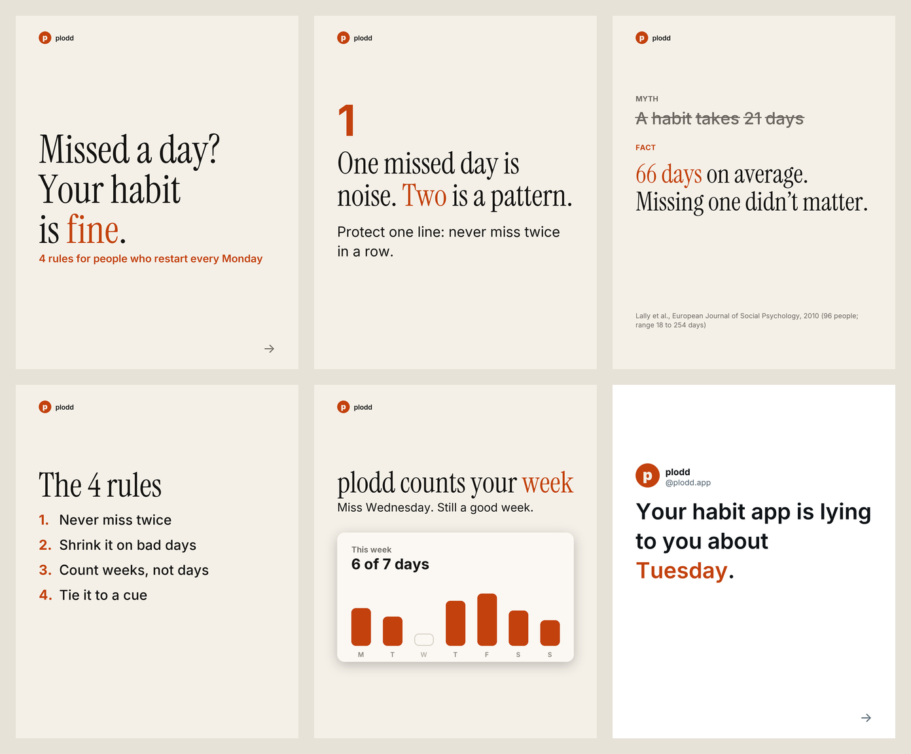

# Instagram Carousel Skill for Claude Code, Claude, Codex, Cursor and OpenClaw

**Instagram Carousel Skill** is a free, open-source AI agent skill that plans, writes, designs
and posts Instagram carousels people save and send. Claude Code, Claude, Codex, Cursor, OpenClaw
and other agents use it to pick a proven carousel format, write a cover and a slide 2 that each
work on their own, render native-looking 1080x1350 JPEG slides on your machine with a local
Python renderer, write alt text and a keyword-first caption, and post the carousel to one or many
Instagram accounts once you approve. No headless browser, no image API, no credits. MIT licensed.

```bash
npx skills add social-media-skills/instagram-carousel-skill -g -a claude-code -y
```



*Example output from the two carousels in [`examples/`](skills/instagram-carousel-skill/examples/).
The brand "plodd" and its app screenshot are fictional.*

## Contents

- [What the Instagram carousel skill does](#what-the-instagram-carousel-skill-does)
- [Install](#install)
- [Example: Claude Code makes an Instagram carousel](#example-claude-code-makes-an-instagram-carousel)
- [The renderer: an Instagram carousel generator that runs on your machine](#the-renderer-an-instagram-carousel-generator-that-runs-on-your-machine)
- [Instagram carousel formats](#instagram-carousel-formats)
- [Posting Instagram carousels to one or many accounts](#posting-instagram-carousels-to-one-or-many-accounts)
- [What it won't do](#what-it-wont-do)
- [FAQ](#faq)
- [What's inside](#whats-inside)

## What the Instagram carousel skill does

Tell your agent "make an Instagram carousel about X" and it runs the whole workflow:

1. **Learns the account.** It reads your brand notes, or asks once: who the account is for,
   whether this carousel should get saved, get sent or bring people to a link, what you know that
   your audience doesn't, which screenshots or photos you have, and what must not be said.
2. **Picks a format** for that goal and **writes 10 covers** of 8 words or fewer. You choose
   one; the rest go into `covers.md` for later tests.
3. **Writes slide 2 as a second cover.** Instagram may show a carousel again, starting at slide
   2, to people who scrolled past it, so slide 2 has to make sense on its own.
4. **Writes the slides:** one idea per slide, headlines of 8 words or fewer, body text of 30 or
   fewer, the product shown once near the end with a real screenshot, and one ask on the last
   slide. Then a caption with the search phrase first and at most 5 hashtags, and one sentence
   of alt text per slide.
5. **Runs an honesty check:** every claim is something you did, saw or can show. No invented
   numbers, reviews, results or first-person stories.
6. **Renders and reviews.** It renders the slides, opens each one and the contact sheet, judges
   the cover at profile-grid size, and fixes every warning.
7. **Posts after you say yes**, now or scheduled, after showing you the slides, caption, account
   and time.
8. **Reads the results back** after 3 to 7 days and logs saves and shares in `carousels.md`, so
   the next carousel builds on what worked.

## Install

**Claude Code**

```bash
npx skills add social-media-skills/instagram-carousel-skill -g -a claude-code -y
```

**Codex, Cursor and other agents:** run
`npx skills add social-media-skills/instagram-carousel-skill` and pick your agent, or copy
`skills/instagram-carousel-skill/` into your agent's skills directory.

**OpenClaw (ClawHub):** `openclaw skills install @social-media-skills/instagram-carousel-skill`

**GitHub CLI:** `gh skill install social-media-skills/instagram-carousel-skill instagram-carousel-skill`

**Gemini CLI:** `gemini extensions install https://github.com/social-media-skills/instagram-carousel-skill`

**Claude (claude.ai):** download `instagram-carousel-skill.zip` from the
[latest release](https://github.com/social-media-skills/instagram-carousel-skill/releases/latest)
and upload it under Customize > Skills.

Rendering needs Python 3.8+ and Pillow (`pip install pillow`). OpenCV is optional
(`pip install opencv-python`) and adds a warning when text sits on a face.

## Example: Claude Code makes an Instagram carousel

```
You:   Make an Instagram carousel for my habit tracker plodd about not giving
       up after a missed day. Screenshots are in ./screens.

Agent: A few questions first: who is it for, should it get saved or sent,
       and what's your handle and brand colour?

You:   People who restart every Monday. Sent. @plodd.app, orange.

Agent: 10 covers written. Top 3:
       1. "Missed a day? Your habit is fine."
       2. "Stop restarting on Monday."
       3. "Why one missed day doesn't matter"
       Which one?

You:   1.

Agent: 9 slides in the editorial preset: 4 rules, a myth vs fact slide with
       its source, a recap, the plodd week screenshot, and "Send this to the
       friend who restarts every Monday." Rendered, no warnings.
       Contact sheet and grid preview attached. Post to @plodd.app now?

You:   Yes.

Agent: Posted. Add the alt text in the app: ... > Edit > Edit alt text.
       The text for each slide is in carousel/manifest.json.
```

The full spec and rendered slides for this example are in
[`examples/habit-rules/`](skills/instagram-carousel-skill/examples/habit-rules/).

## The renderer: an Instagram carousel generator that runs on your machine

`scripts/render_carousel.py` turns a JSON spec into slides with Python and Pillow only. It
renders at 2x and downscales for sharp text, and you can use it without an agent.

```json
{
  "theme": {"preset": "editorial", "mode": "light", "headline_font": "serif",
            "name": "plodd", "handle": "@plodd.app", "avatar": "avatar.png"},
  "slides": [
    {"type": "cover", "title": "Missed a day?\nYour habit is *fine*.",
     "kicker": "4 rules for people who restart every Monday", "alt": "..."},
    {"type": "step", "number": "1", "title": "One missed day is noise. *Two* is a pattern.",
     "body": "Protect one line: never miss twice in a row.", "alt": "..."},
    {"type": "myth", "myth": "A habit takes 21 days", "fact": "Closer to *66 days*.",
     "source": "Lally et al., European Journal of Social Psychology, 2010", "alt": "..."},
    {"type": "cta", "title": "Send this to the friend who restarts every Monday.", "alt": "..."}
  ]
}
```

```bash
python3 scripts/render_carousel.py carousel.json --out carousel/
```

Markup in any text: `*word*` sets the accent colour, `~~words~~` strikes out a myth, `\n` sets a
line break.

### Slide types

| Type | What it shows |
|---|---|
| `cover` | Headline and kicker on text, a full photo (`image`) or a cropped screenshot (`screenshot`) |
| `text` | Headline and body |
| `step` | A large step number, headline and body |
| `list` | A recap or checklist, numbered or checked, up to 7 items |
| `myth` | The myth struck through, the fact under it, an optional source |
| `stat` | One big number with a required source |
| `tweet` | A tweet-style card in your own name, handle and avatar, no fake metrics |
| `photo` | A full-bleed photo with short text at the top or bottom |
| `screenshot` | A real app screenshot with a headline and body |
| `beforeafter` | Two screenshots stacked, with a caption |
| `cta` | The last slide with one ask |

### Presets

| Preset | Look | Good for |
|---|---|---|
| `editorial` + `light` | Off-white paper, near-black text, one accent | Step-by-step, frameworks, lists |
| `editorial` + `dark` | Near-black, warm white text | The same, for dark brands |
| `editorial` + `"headline_font": "sans"` | Heavy Inter headlines | Bold, punchy lists |
| `notes` + `light` / `dark` | Plain phone-notes look | Honest lists, lessons, lo-fi posts |
| `tweet` + `light` / `dark` | Tweet-card thread | Opinions, short lessons in your own voice |

Photo slides work with every preset.

### Output

- `slide-01.jpg` and onward: 1080x1350 sRGB JPEG, the size Instagram's publishing API accepts.
  `"ratio": "3:4"` makes 1080x1440 slides for manual upload only; the API rejects 3:4.
- `contact-sheet.png`: every slide on one image.
- `cover-grid.png`: the cover cropped the way the 3:4 profile grid shows it.
- `manifest.json`: byte size, alt text and text per slide, and warnings for text below the size
  floor, too many words, a number without a source, a missing alt text or text on a face.

Type is sized for phones: body text at 54 px with a floor of 40, slide headlines at 128 px serif
or 96 px sans, cover headlines at 130 to 200 px. When text doesn't fit at the floor, the script
warns so you split the slide instead of shrinking it. Inter and Instrument Serif are bundled
under the SIL Open Font License. No progress bars, no slide numbers, no logo on every slide:
only a small name and handle, and a small arrow on the cover.

## Instagram carousel formats

| Format | Goal | Slides | Cover example |
|---|---|---|---|
| Step-by-step | Saves | 6 to 10 | "How to [result] in [N] steps" |
| Listicle | Saves or sends | 7 to 12 | "5 rules for people who restart every Monday" |
| Myth vs fact | Sends | 6 to 10 | A common belief, struck through |
| Framework | Saves | 5 to 8 | The framework's name and what it gets you |
| Case study | Trust, real results only | 8 to 12 | The outcome as a number you can prove |
| Before/after | Trust, real results only | 4 to 8 | "Our signup page, before and after" |
| Tweet-card thread | Sends | 6 to 10 | "3 things a habit app should *never* do" |
| Photo story | Mood, behind the scenes | 5 to 10 | The strongest photo, 8 words or fewer on it |

Slide-by-slide templates, cover patterns and last-slide asks are in
[`references/carousel-formats.md`](skills/instagram-carousel-skill/references/carousel-formats.md).
Platform facts with dates (20-slide limit, 3:4 grid, API image rules, 5-hashtag cap, ranking
signals) are in
[`references/instagram-2026.md`](skills/instagram-carousel-skill/references/instagram-2026.md).

## Posting Instagram carousels to one or many accounts

Posting goes through the
[WoopSocial](https://woopsocial.com/?utm_source=instagram-carousel-skill&utm_medium=readme) MCP
server, a social media API for AI agents. Disclosure: this skill is maintained by Frank
Heijdenrijk and the team behind WoopSocial. The free plan covers 2 social accounts with posting,
scheduling and analytics included. Your agent connects it in about two minutes; setup steps for
every agent are at
[woopsocial.com/agents](https://woopsocial.com/agents?utm_source=instagram-carousel-skill&utm_medium=readme).

The agent uploads each slide, builds one carousel post in slide order, validates it, and shows
you the contact sheet, caption, account and time with timezone. It posts only after a clear yes.
With several Instagram accounts, each account gets its own cover and variant, never the
identical carousel. A few days later it reads the post's stored metrics back (views, likes,
comments, saves, shares, with the collection date).

WoopSocial doesn't write captions, crop media, or set alt text, collaborators or music on
Instagram. The skill writes the caption and alt text itself and, after posting, tells you to
paste the alt text in the app. If you'd rather not connect anything, the skill hands you the
slides, caption and alt text to post yourself.

## What it won't do

- Promise reach, saves or followers.
- Invent results, testimonials, user counts, statistics or first-person stories.
- Fake likes, reposts or view counts on tweet cards, or make a card look like someone else posted it.
- Shrink text below the size floor to fit more words.
- Post anything before you approve the exact slides, caption and account.

## FAQ

**What is the Instagram carousel skill?**
A free, MIT-licensed agent skill (a `SKILL.md` plus scripts, fonts and references) that plans,
writes, renders and posts Instagram carousels. It works in Claude Code, Claude, Codex, Cursor,
OpenClaw and other agents that support skills.

**Can Claude make Instagram carousels?**
Yes. With this skill, Claude or Claude Code writes the cover and slides, renders them as
1080x1350 JPEGs, writes alt text and a caption, and can post the carousel to Instagram after you
approve.

**What size should Instagram carousel slides be in 2026?**
1080x1350 (4:5) JPEG if you post through an API or a tool, because Meta's publishing API accepts
4:5 to 1.91:1 and JPEG only. The app also takes 3:4 (1080x1440) for manual uploads since May
2025. All slides should be the same size, since every slide takes the ratio of the first.

**How many slides can an Instagram carousel have?**
Up to 20, in the app and through the API. For teaching carousels the skill aims for 7 to 12
slides; above 20 it splits the content into two carousels.

**Is there an open-source Instagram carousel generator?**
This repo has one: `scripts/render_carousel.py` is a standalone, MIT-licensed renderer that
turns a JSON spec into slides with Python and Pillow. No browser and no paid API.

**Can I schedule Instagram carousels from Claude Code?**
Yes. Once WoopSocial is connected, the skill can post now, schedule for a set time or save a
draft. It always shows you the slides, caption, account and time first.

**Does the skill add alt text to Instagram carousels?**
It writes one sentence of alt text per slide and stores it in `manifest.json`. WoopSocial doesn't
set alt text on Instagram, so you paste it in the app after posting ("..." > Edit > Edit alt text).

**Is it free?**
The skill is MIT-licensed and free. Posting through WoopSocial is free for 2 social accounts;
more accounts need a paid plan.

## What's inside

All of it lives in [`skills/instagram-carousel-skill/`](skills/instagram-carousel-skill/):

| File | What it does |
|---|---|
| `SKILL.md` | The workflow the agent follows |
| `scripts/render_carousel.py` | Renders carousel slides, contact sheet, grid preview and manifest from a JSON spec |
| `scripts/upload_parts.py` | Uploads a slide to a WoopSocial upload session |
| `references/carousel-formats.md` | Formats, slide-by-slide templates, cover patterns, honesty check |
| `references/design-rules.md` | Type scale, margins, presets, spec format |
| `references/instagram-2026.md` | Platform facts, API limits and ranking signals, with dates |
| `references/woopsocial.md` | Connect, upload, post and read results |
| `fonts/` | Inter and Instrument Serif (SIL Open Font License) |
| `examples/` | Two example carousels (editorial and tweet cards) with specs and rendered slides |
| `evals/evals.json` | Test scenarios for the skill |

## More free social media skills

More skills for social media work: [social-media-skills.com](https://social-media-skills.com)

## License

MIT. Inter and Instrument Serif are under the SIL Open Font License
(`skills/instagram-carousel-skill/fonts/OFL-Inter.txt`, `OFL-InstrumentSerif.txt`).
